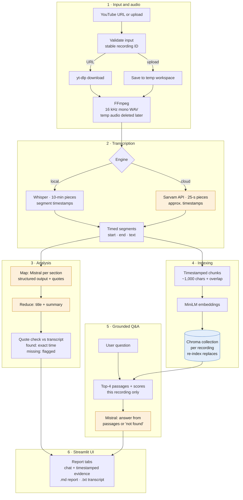

# Intelligent Video Understanding AI Assistant

Turn a YouTube video, lecture, podcast or meeting recording into a **timestamped transcript**, a **summary**, extracted **decisions, action items and open questions**, and a **chat that answers from the recording and shows its evidence**.

Built with Python, OpenAI Whisper (local), Sarvam AI (optional, Hindi/Hinglish), Mistral AI via LangChain, Hugging Face embeddings, ChromaDB and Streamlit.

## Why this exists

Long recordings hide information. A two-hour lecture is 15-20k words with no structure; the one decision you need from last week's meeting means re-watching it. A transcript alone does not fix this: it is still a wall of text.

This app adds three layers on top of transcription:

1. **Structure.** A summary plus decisions, action items and open questions, each linked to a timestamp and a verbatim supporting quote.
2. **Search by meaning.** The transcript is split into timestamped chunks, embedded locally and stored in ChromaDB, one collection per recording.
3. **Grounded Q&A (RAG).** For each question the app retrieves the most relevant passages *from that recording only* and asks the LLM to answer using only those passages, citing them. If the passages do not contain the answer, it says so.

## Features

- YouTube links (`watch`, `youtu.be`, `shorts`, `live`) or uploaded audio/video files
- Three transcription modes:

  | Mode | Runs | Output | Timestamps |
  |---|---|---|---|
  | Whisper - keep original language | local | language spoken | **Whisper segment times** (a few seconds of speech each) |
  | Whisper - translate to English | local | English | Whisper segment times |
  | Sarvam AI - Hindi/Hinglish to English | cloud | English | **Approximate**: Sarvam returns text only, so each line is placed at its 25-second audio piece (shown with `~`) |

- Map-reduce analysis with structured output; every extracted item carries a quote that is checked against the transcript
- Evidence-backed chat: numbered passages, time ranges and similarity scores under every answer
- Per-recording vector index, no duplicates on re-processing, one-click deletion of a single recording's index
- Export: Markdown report and timestamped TXT transcript
- Audio is decoded and split into manageable pieces to limit preprocessing memory usage.

## Architecture



Orange boxes are remote API calls (data leaves your computer); the blue cylinder is the local vector store; everything else runs locally. Remote calls are retried with backoff on rate-limit and server errors (HTTP 429/5xx).

Code layout: `pipeline.py` holds all processing (no UI code); `app.py` is the Streamlit interface; `test_pipeline.py` is the offline test suite.

## How it works

1. **Validate input.** URLs are parsed; only single YouTube videos are accepted. Uploads are checked by extension. Each recording gets a stable ID: `yt-<videoID>` or `file-<sha256 of content>`.
2. **Get audio.** yt-dlp downloads the audio stream; uploads are saved to `workspace/`. FFmpeg converts everything to 16 kHz mono WAV.
3. **Split.** The WAV is read piece by piece with Python's `wave` module (10 minutes for Whisper, 25 seconds for Sarvam, whose synchronous API accepts at most 30 seconds).
4. **Transcribe.** Whisper runs locally and returns segments with start/end times; piece offsets are added to make them absolute. Sarvam's `/speech-to-text` endpoint (`mode=translate`) returns English text for each piece. Temporary audio is deleted afterwards, even on failure.
5. **Analyse.** Segments are grouped into ~12,000-character sections. Each section gets one Mistral call with a strict schema (summary points, decisions, action items, open questions, each with a verbatim quote). One more call writes the title and summary. Items are merged in Python, so their quotes and timestamps survive. Calls per recording: sections + 1.
6. **Check quotes.** Each quote is searched for in the transcript (ignoring case and punctuation). If found, the item gets the exact time of the matching segments and a "quote found" mark. If not, it is flagged "quote not found" and placed at its section's time range.
7. **Index.** Whole segments are packed into ~1,000-character chunks; each chunk starts with the last segment of the previous one (overlap) and keeps `recording_id`, `chunk_index`, `start`, `end`. A local sentence-transformers model embeds them, and they are stored in this recording's own Chroma collection.
8. **Answer.** The question is embedded, the 4 most similar chunks are retrieved with cosine-similarity scores, and Mistral answers using only those numbered, timestamped passages. If they do not contain the answer, the model must reply with a fixed "couldn't find this" sentence, which the UI shows as a warning (the closest passages remain visible).

### What "quote found" does and does not mean

A "quote found" mark means the supporting words appear verbatim in the transcript. It **does not** prove the decision or action item was interpreted correctly: the model can attach a real quote to a wrong conclusion (for example, calling a proposal a decision). It also cannot catch transcription errors in the quote itself. Treat items as pointers to check at their timestamp, not as facts.

## Prerequisites

- **Python 3.12** (recommended). 3.11 and 3.13 also work: Whisper declares support up to 3.13, and Windows wheels for PyTorch, numba, ChromaDB/onnxruntime, tokenizers and Deno are available for 3.11-3.13. 3.14 is not recommended yet (Whisper does not list it).
- **FFmpeg** on PATH
- ~4 GB free disk (PyTorch, Whisper and embedding weights) and 8 GB RAM for the `small` Whisper model
- A **Mistral API key**; a **Sarvam API key** only for the Sarvam mode

## Installation (Windows, PowerShell)

```powershell
# 1. Tools (skip what you already have), then open a NEW terminal
winget install Python.Python.3.12
winget install Gyan.FFmpeg
ffmpeg -version

# 2. Project and virtual environment
cd intelligent-video-assistant
py -3.12 -m venv .venv
.venv\Scripts\Activate.ps1
# If activation is blocked: Set-ExecutionPolicy -Scope CurrentUser RemoteSigned

# 3. CPU-only PyTorch first, then everything else
python -m pip install --upgrade pip
pip install torch --index-url https://download.pytorch.org/whl/cpu
pip install -r requirements.txt
```

With an NVIDIA GPU, replace step 3's PyTorch line with the CUDA command from https://pytorch.org/get-started/locally/. Whisper uses the GPU automatically when PyTorch can see it.

macOS/Linux: `python3.12 -m venv .venv && source .venv/bin/activate`, install FFmpeg with `brew install ffmpeg` or `sudo apt install ffmpeg`, then step 3.

## Configuration

```powershell
copy .env.example .env
notepad .env
```

| Variable | Required | Default | Purpose |
|---|---|---|---|
| `MISTRAL_API_KEY` | yes | - | analysis and chat |
| `SARVAM_API_KEY` | Sarvam mode only | - | Hindi/Hinglish to English transcription |
| `WHISPER_MODEL` | no | `small` | `tiny`/`base` are faster, `medium`/`large-v3` more accurate; `turbo` cannot translate |
| `MISTRAL_MODEL` | no | `ministral-3b-latest` | Mistral chat model |
| `SARVAM_MODEL` | no | `saaras:v4` | Sarvam speech model |
| `EMBEDDING_MODEL` | no | `sentence-transformers/all-MiniLM-L6-v2` | English-centric; use `sentence-transformers/paraphrase-multilingual-MiniLM-L12-v2` for non-English transcripts |

`.env` is listed in `.gitignore`. Keys are read only from the environment, never from source code.

## Running

```powershell
pytest -q               # offline tests, no keys or network needed
streamlit run app.py    # opens http://localhost:8501
```

The first run downloads the Whisper weights (~460 MB for `small`) and the embedding model (~90 MB).

## Usage

**Process a recording.** In the sidebar choose *YouTube URL* or *Upload a file*, pick a transcription mode and press **Analyze**. Progress appears step by step. Uploads are limited to 200 MB by Streamlit's default; raise it with `streamlit run app.py --server.maxUploadSize 1000`.

**Chat.** Open the **Ask** tab and ask questions such as "What did they decide about the launch date?". Each answer cites passages like `[2]`; expand *Evidence used* to read them with their time ranges and similarity scores. Questions are answered independently (there is no conversation memory), so ask complete questions rather than "what about that?".

**Export.** The **Summary** tab has *Download report (.md)* and *Download transcript (.txt)*. Sarvam timestamps are marked with `~`.

**Manage the index.** Re-analysing the same video or file rebuilds its index instead of duplicating it. *Delete this recording's index* removes only that recording's collection from `chroma_db/`.

## Privacy and costs

| Component | Where it runs | Data leaving your computer |
|---|---|---|
| FFmpeg, Whisper, embeddings, ChromaDB | your computer | none (model weights are downloaded once) |
| yt-dlp | your computer | requests to YouTube |
| Mistral | Mistral's servers | transcript text and your questions |
| Sarvam (optional mode) | Sarvam's servers | your audio |

- **External services:** Transcript text and questions are sent to Mistral for analysis and chat. In Sarvam mode, audio is sent to Sarvam for transcription. Review the providers' data-handling policies before processing confidential recordings.
- **API costs:** Usage is subject to the providers' current pricing, quotas, and terms. Check their official documentation before use.
- Downloaded audio is deleted after transcription. Transcript chunks stay in `chroma_db/` until you delete the index.

## Limitations

- Transcription accuracy depends on audio quality and the selected model.
- Audio-only processing; speaker identification and visual content analysis are not supported.
- RAG may miss relevant context or generate unsupported answers.
- Long recordings can be slow to process on a CPU.


## Troubleshooting

| Problem | Fix |
|---|---|
| "FFmpeg was not found on PATH" | Install FFmpeg, then open a new terminal so PATH is refreshed. |
| YouTube download fails | `pip install -U "yt-dlp[default,deno]"`. Private, age-restricted or region-locked videos cannot be downloaded. |
| "rejected the API key" | Check the key in `.env`, then restart Streamlit. |
| "rate limit reached" | Free-tier limit. Wait a minute; the app already retries with backoff. |
| Translate mode returns the original language | You are using `turbo`; set `WHISPER_MODEL=small` or larger. |
| Very slow transcription | Use `WHISPER_MODEL=base` or `tiny`, or a GPU build of PyTorch. |
| Poor answers on a Hindi transcript | Set a multilingual `EMBEDDING_MODEL` and re-analyse. |

## How retrieval quality can be evaluated

Retrieval and generation fail differently, so check them separately. Write about 10 questions about a recording and note the timestamp where each answer occurs. **Retrieval** is working if the correct time range appears among the evidence passages (hit@4). **Generation** is working if, given correct evidence, the answer is faithful to it and cites it. A wrong answer with the right evidence is a generation problem; a wrong answer without it is a retrieval problem. The offline tests check retrieval logic with a deterministic embedding model; they do not measure the real model's quality.


## Engineering Contributions

This project focuses on building a practical video-understanding workflow with an emphasis on reliability, traceability, and usability.

Key engineering contributions include:

- Isolated vector indexes for individual recordings to prevent cross-recording retrieval contamination.
- Timestamped evidence passages for answers generated through retrieval-augmented generation (RAG).
- Quote validation for extracted decisions, action items, and open questions.
- Structured processing pipelines with temporary-file cleanup and API error handling.
- Offline automated tests covering important pipeline behaviours.
- Exportable summaries and timestamped transcripts.
